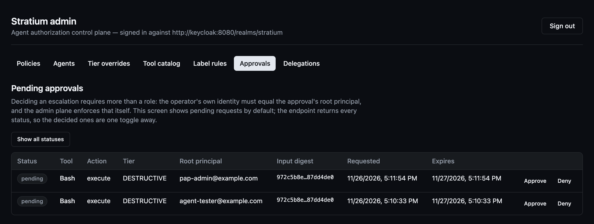
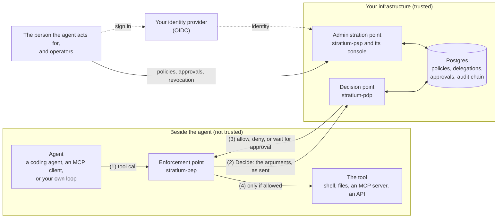

# Stratium

**Authorization for AI agents, decided per tool call.**

An agent acting on someone's behalf makes thousands of tool calls an hour, with
the same credentials the whole time. Most authorization stops at "is this
session valid". Stratium asks a narrower question, every time:

> May **this agent**, acting under **this person's** delegated authority, at
> **this point in a delegation chain**, perform **this action** on **this
> resource**, right now?

`Bash("ls -la")` and `Bash("rm -rf /")` are the same tool, agent, session and
credentials. To Stratium they are different questions.


*A real Claude Code session against a local stack. The read is refused. The
`rm -rf` waits until the person the agent is acting for approves it, then
runs. The recording is cropped to leave out the terminal's status row and the
account's plan name.*

**📖 Documentation: [docs.stratium.dev](https://docs.stratium.dev)** ·
[Quickstart](https://docs.stratium.dev/quickstart/) ·
[Concepts](https://docs.stratium.dev/concepts/) ·
[What it does not stop](https://docs.stratium.dev/limits/)

> Stratium is a **pre-release** (`v0.1.0`). Settings, wire contracts and
> defaults can still change between versions.

## What it does

- **Decides every tool call on the server.** The enforcement point beside the
  agent forwards the call's arguments as they are. The decision point derives
  how dangerous the action is and what it touches. The component being policed
  never classifies its own actions.
- **Bounds an agent by a delegation.** A person hands an agent a tool list, a
  danger ceiling, a path scope and a data classification cap. No policy can
  raise them, and a sub-agent can only be handed less.
- **Asks a person when it matters.** Above a threshold you set, a call waits
  for the person the agent is acting for to approve that one call.
- **Stops an agent now.** Revoke a session or suspend an agent and the next
  tool call is refused.
- **Records every decision** in a tamper-evident audit chain.
- **Denies when unsure.** An unreachable decision point, an unreadable
  session, an unlabelled resource under a cap: each is a denial.



*A call above the threshold waits here. Only the person the agent is acting
for can approve it.*

Policies are written in [Cedar](https://www.cedarpolicy.com),
[Rego](https://www.openpolicyagent.org/docs/latest/policy-language/), XACML or
JSON, and can be mixed.

## Where it sits

| You run | Stratium enforces through |
|---|---|
| A coding agent: Claude Code, Codex, Cursor, Copilot CLI, Goose, OpenCode, Kiro CLI, Devin, Antigravity CLI | a hook the harness calls before each tool call |
| An MCP server | a stdio proxy in front of it, or [agentgateway](https://agentgateway.dev) |
| A LiteLLM proxy | a guardrail |
| An HTTP API behind Envoy | `ext_authz` |
| A gRPC service | a proxy |
| Your own agent loop | the Python SDK |

[Which one do I want?](https://docs.stratium.dev/pep/) Each harness page says
how it was verified.

## Try it

You need Docker with `docker compose`, Go, Python 3 and Node.js.

```bash
git clone https://github.com/stratiumdata/stratium.git && cd stratium
deploy/stratium up --harness claude    # or: --harness codex
```

That builds and starts a local stack, registers an agent, starts a session and
wires the hook, ending on a denial you can see. The
[quickstart](https://docs.stratium.dev/quickstart/) walks through each step
with the output to expect, and how to take it all down again.

## What it does not stop

Stratium is not a sandbox. A hook installed per project can be removed by the
agent it governs, the shell classifier is a heuristic, and a path scope checks
a command's words and not its effects.
[Read the limits](https://docs.stratium.dev/limits/) before you rely on it.

## Three parts



The enforcement point forwards a tool call and enforces the answer. The
decision point works out what the call is and whether it may go ahead. The two
trusted services share one database and never take the enforcement point's
word for anything.

| Part | Binary | What it does |
|---|---|---|
| Decision point (PDP) | `stratium-pdp` | Answers one question, `Decide`. Owns all classification and token verification. |
| Administration point (PAP) | `stratium-pap` | Policies, agents, approvals and audit, with a web console. People sign in over OIDC. |
| Enforcement point (PEP) | `stratium-pep` | Runs beside the agent. Turns a tool call into a question, and the answer into a block or a pass. Not trusted, by design. |

## Repository layout

- `services/`: the Go module. PDP, PAP and PEP.
- `clients/ui/`: the admin console. `sdk/python/`: the Python SDK.
- `deploy/`: the Docker stack, seed data and the quickstart script.
- `example/`: runnable examples against a local model.
- `docs/`: the source of [docs.stratium.dev](https://docs.stratium.dev).

## Development

    make build        # builds the admin console, then the Go binaries
    make test         # Go tests with -race, plus the console's lint and tests
    make lint
    make conformance  # authorization conformance properties
    make integration  # the whole stack in Docker, and the tests against it

Use `make`, not `go build` directly: the admin console is embedded in
`stratium-pap`, so Go commands fail until it has been built.
[`CONTRIBUTING.md`](CONTRIBUTING.md) explains why, and what `make integration`
needs.

## License

Apache-2.0. See [`LICENSE`](LICENSE). Contributing:
[`CONTRIBUTING.md`](CONTRIBUTING.md). Security reports:
[`SECURITY.md`](SECURITY.md).
