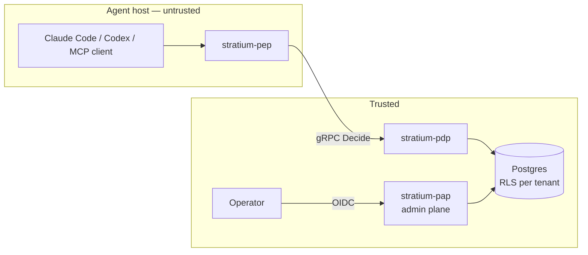
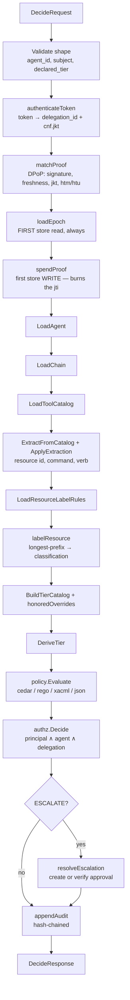
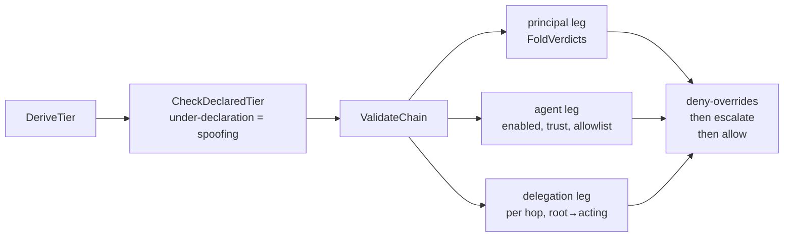

# Stratium: a technical walkthrough

For an engineer who has to work on this system and wants to know how it
actually fits together — not the pitch, the mechanism.

Everything below was checked against the code and, where it is a runtime claim,
against a live stack on 2026-08-21. Traces are copied from that run.

---

## 1. What the system decides

One question, asked per action:

> May **this agent**, acting under **this person's** delegated authority, at
> **this point in a delegation chain**, perform **this action** on **this
> resource**, right now?

Not "is this user logged in", not "does this API key exist". The unit of
authorization is a single tool call — `Bash("rm -rf /")`, `Read("/secret/plans.txt")`,
`POST /v1/refunds` — evaluated against authority that was delegated, is
time-boxed, and can be narrowed at every hop.

### The one idea everything else follows from

**The component being policed never classifies its own actions.**

The predecessor system ran a regex classifier inside the agent's own process,
decided "this looks like a read", and told the server so. The server believed
it. That is spec defect **D1**, and it made every enforcement surface
bypassable by one lie: pick a benign tool name, send a benign tier, do whatever
you want.

So in this system the enforcement point forwards the tool call's arguments
**verbatim, as opaque bytes**, and the server derives everything — the tier, the
resource identity, the verb, the classification. `cmd/stratium-pep/hook.go` has
a long comment about the three tables that used to live there and were deleted;
that deletion is the architecture.

The practical test for any change you make: *could a hostile PEP get a better
answer by lying?* If yes, the logic is in the wrong process.

---

## 2. Three planes



| Plane | Binary | Job | Trust |
|---|---|---|---|
| **PAP** — administration | `cmd/stratium-pap` | CRUD for policies, agents, tool catalog, tier overrides, label rules, approvals. Authenticates a *human* via OIDC and gates every route on a role claim. Embeds the admin UI. | The only internet-facing component |
| **PDP** — decision | `cmd/stratium-pdp` | Answers `Decide`. Owns all classification, all derivation, all verification. Serves exactly one tenant, named at startup. | Trusted |
| **PEP** — enforcement | `cmd/stratium-pep` | Sits beside the agent. Turns a tool call into a `DecideRequest`, turns the answer into a block or a pass. Decides nothing. | **Untrusted by design** |

`stratium-pdp` is the only writer of decisions and the only verifier of tokens.
There is no second decision implementation anywhere — `internal/authz`'s package
doc names "three parallel implementations drifting apart" as the specific failure
it exists to prevent.

PEP-to-PDP traffic is gRPC over TLS. Plaintext needs an explicit opt-in on both
ends (`STRATIUM_GRPC_INSECURE` on the PDP, `STRATIUM_PEP_PDP_INSECURE` on the
PEP), which only the local dev stack sets.

The PDP authenticates who a new session is for. A root delegation's principal
comes from an OIDC token the PDP verifies (`STRATIUM_PRINCIPAL_OIDC_ISSUER`,
`STRATIUM_PRINCIPAL_OIDC_AUDIENCE`, `STRATIUM_PRINCIPAL_CLAIM`), not from the
request. A child delegation is authorized by its parent's token and acts for
its chain's root principal. Turning this off needs an explicit opt-in
(`STRATIUM_PRINCIPAL_AUTH_INSECURE`), which only the local dev stack sets.

The local dev stack (`deploy/docker/docker-compose.yml`) runs **21 services**:
Postgres, ten differently-configured PDPs, two PEPs, Envoy with an upstream, a
gRPC target, Keycloak, three PAPs, and LiteLLM. Ten PDPs because each
integration test family needs its own tenant and config; one of them,
`pdp-oidc`, verifies principals against the stack's Keycloak.

---

## 3. Vocabulary

Read this once; the rest of the document assumes it.

**Tenant** — the isolation boundary. *Never* a request field. It is startup
configuration (`STRATIUM_TENANT_ID`) and the predecessor's client-supplied
`x-user-id` header is called out in the proto as the authentication bypass this
rule exists to prevent.

**Agent** — a registered actor: a trust tier, an enabled/suspended pair of flags,
and an optional tool allowlist.

**Delegation** — a signed grant from a principal to an agent, bounded by
`max_action_tier`, `approved_tools`, `resource_constraints`,
`classification_caps`, `expires_at`, and an optional `escalate_at`. Delegations
form a **chain**: a child may only ever narrow its parent
(`permset.ScopeNarrows`). The acting delegation is the last hop. The principal
of a chain is *never* taken from the request: `CreateDelegation` reads a root
delegation's principal from a verified OIDC token (`principal_token`), and a
child, authorized by its parent's token (`parent_token`), always acts for its
chain's root principal.

**Action tier** — how dangerous the action is, derived server-side:

| | Tier | Meaning |
|---|---|---|
| 0 | `REASONING` | no side effects |
| 1 | `READ_ONLY` | reads data |
| 2 | `INTERNAL_MODIFY` | mutates internal state |
| 3 | `EXTERNAL_COMMS` | reaches outside the trust boundary |
| 4 | `DESTRUCTIVE` | irreversible or financially binding |

**Agent trust tier** — how much the agent is trusted: `UNVERIFIED` (0),
`REGISTERED` (1), `CERTIFIED` (2), `PLATFORM_TRUSTED` (3). `DefaultTrustTable`
maps each action tier to the minimum trust that may attempt it — `DESTRUCTIVE`
requires `PLATFORM_TRUSTED`. A tier missing from the table returns the *highest*
requirement, so an unmapped tier fails closed.

**Classification** — a `(hierarchy, level)` pair from `pkg/classification`:
`nato` (`UNCLASSIFIED`…`TOP-SECRET`) and `commercial` (`PUBLIC`…`HIGHLY-CONFIDENTIAL`).
A delegation carries per-hierarchy caps.

**Epoch** — a per-tenant integer bumped by a *database trigger* on every
authorization-configuration write. It is the cache-invalidation clock. See §9.

> **Zero values are deliberate.** `EffectDeny` is `0` in Go *and* on the wire, so
> a field that is never set, or that decodes from a truncated message, reads as
> DENY. `ActionTierReasoning` is `0` so the least-privileged tier is what an
> unset tier means. Do not reorder either enum.

---

## 4. The decision path

This is the spine. `internal/pdpgrpc/server.go`'s `Decide`, in order:



Four ordering facts that are load-bearing, not incidental:

1. **Authentication is first, before any store call.** A bad token costs one
   audit write — never an agent lookup or a chain load.
2. **The epoch is the first store read, always.** `TestDecide_EpochIsTheFirstStoreRead`
   is the guard. A decision must be stamped with the config generation it was made
   under, or the cache in §9 cannot be safely invalidated.
3. **Spending a DPoP `jti` is the first store *write*, and it comes after every
   cheap check.** A malformed proof must never burn a `jti` an honest client
   would legitimately retry with.
4. **Extraction and labelling happen before the tier table is built**, so the
   resource label is on the map that the policy engine, the resource
   constraints, and the cap check all see.

Every load failure on this path — catalog, label rules, tier overrides —
**denies and audits** rather than proceeding as though the tenant had no rows.
The argument is the same each time: the row that failed to load might be the one
that would have raised the tier.

---

## 5. The compound decision

`internal/authz` is pure: no database handle, no network client, no ambient
clock. The caller loads the data; `authz` decides.

```
allow = principal ∧ agent ∧ delegation
```

Three **independent AND terms**. That structure is the whole reason a policy
cannot exceed a delegation: policy only ever answers the principal leg, so an
ALLOW there is one term of a conjunction, not an override of the other two.



**Deny-overrides, in a fixed order** (principal, agent, delegation) so
attribution is deterministic. Escalate surfaces only when nothing denies.

**The principal leg** folds policy verdicts (`FoldVerdicts`): any deny → DENY;
else any escalate → ESCALATE; else no allow → **DENY (default-deny)**; else
ALLOW. A nil or empty verdict slice folds to deny, so a caller that forgets to
evaluate policy denies rather than permitting. Among equally decisive verdicts
the fold picks the lexicographically smallest `(Source, PolicyID)` — so the
recorded reason does not change run to run because a map iterated differently.

**The agent leg** — disabled, suspended, insufficient trust for the derived
tier, or a tool outside the agent's allowlist.

**The delegation leg** walks *every hop* root-first and is the structural
ceiling — never policy-configurable. Per hop: revoked → deny; expired → deny;
`derived > max_action_tier` → deny; tool not in `approved_tools` → deny;
resource constraint unsatisfied → deny; classification cap exceeded → deny. If
`escalate_at <= derived <= max_action_tier`, the hop *records* an escalation but
the walk continues — a deeper hop can still deny, and deny beats escalate inside
the leg exactly as it does across legs.

Nothing in the policy engines can raise a ceiling. That is not enforced by a
check; it is enforced by the conjunction.

---

## 6. Where the tier comes from

`authz.DeriveTier` resolves in this order:

1. **Tenant overrides** (`tier_overrides`), keyed most-specific-first:
   `Tool:verb`, then `Tool`, then `verb`.
2. **Tool catalog** (`tool_catalog`, per tenant) merged over `DefaultCatalog()`.
3. **Built-in classifier** (`BuiltinTier`) — regexes over the raw command.
4. Otherwise the tenant's `UnknownTier` floor, or an error if `DenyUnknown`.

Then, **above all four**:

> A positive destructive-or-external match on `raw_input` is *evidence* and is
> never lowered.

Overrides and catalog rows are keyed on a tool **name**. Without the evidence
rule, a PEP could pick a benign name for a hostile call and choose its own tier —
D1 by another route. The rule lives in `DeriveTier` itself, at the single
boundary every caller routes through, because it was once implemented inside
`BuiltinTier` and a later catalog lookup layered on top silently bypassed it.

Evidence only ever **raises**. A catalog entry higher than the evidence stands,
which keeps the raise-only override rule intact.

### Raise-only overrides, enforced twice

An override may only ever raise a tier. That is checked at **write time** in the
PAP and **again at read time** in `Decide` (`honoredOverrides`), against the
catalog just loaded for this decision. The read-time check is the one that
cannot be bypassed — the schema's own `CHECK` compares against a stored
`builtin_tier` column that a superuser INSERT supplies for itself and that goes
stale the moment the catalog changes. A row that fails is **dropped, not fatal**:
resolution falls through to the higher tier beneath it, and a log line names the
key. One bad row costs the tenant that override, not every decision.

### Live: same tool, three tiers

Session granted `max_action_tier = 3 (EXTERNAL_COMMS)`, tools `Read, Write, Bash`.

```
$ hook '{"tool_name":"Bash","tool_input":{"command":"ls -la"}}'
  exit=0                                          # READ_ONLY

$ hook '{"tool_name":"Bash","tool_input":{"command":"curl https://example.com"}}'
  exit=0                                          # EXTERNAL_COMMS — at the ceiling

$ hook '{"tool_name":"Bash","tool_input":{"command":"rm -rf /"}}'
  {"hookSpecificOutput":{...,"permissionDecision":"deny","permissionDecisionReason":
   "action tier DESTRUCTIVE exceeds delegation max_action_tier EXTERNAL_COMMS at depth 0"}}
  exit=2

$ hook '{"tool_name":"Grep","tool_input":{"pattern":"x"}}'
  {"...":"tool \"Grep\" not in delegation approved_tools at depth 0"}
  exit=2
```

One tool, one delegation, three different outcomes decided entirely by argument
text the PEP forwarded without reading.

> **The classifier is a heuristic, and the code says so.** `tier.go` carries an
> explicit RESIDUAL RISK note: base64-piped-to-`sh` defeats any static matcher.
> The real controls are the delegation ceiling, the agent allowlist, and
> escalation. The classifier's job is to stop an action being *accidentally* or
> *casually* under-rated.

---

## 7. The tool catalog, and the line it must not cross

`tool_catalog` is per tenant. Each row names, for one tool: its tier (nullable),
its `verb`, which raw-input field holds the **resource id**, and which holds the
**command**.

```sql
(tenant, 'Read',  1, 'read',    'file_path', NULL)
(tenant, 'Bash',  NULL, 'execute', NULL,     'command')   -- no fixed tier
```

`Bash` has **no tier and a command field** — a single fixed tier can never
describe a shell command, so its tier is derived per call from the command text.
That row only exists as a database row; `DefaultCatalog()` structurally cannot
express it.

The boundary, stated in `extract.go`'s package doc and worth internalising:

> This file may look up **which field** holds a value, by name. It may never
> inspect what a value **means**.

And the mirror, in `label.go`:

> This file says what a value means, and never looks at a field the caller named.

`ApplyExtraction` **replaces** rather than merges for a catalogued tool: the
resource map becomes `{}` or `{"id": <extracted>}` and nothing else. That single
constrained shape is why "the PDP never infers a classification from caller
input" holds by construction — there is no map-merge a future edit could smuggle
a `classification` key through. `action.RawInput` is never touched on either
branch, so the evidence check in §6 always sees exactly what the caller sent.

A tool with **no** catalog row passes through completely unchanged — that is the
regression guard, and it holds per tool, not just per tenant.

---

## 8. Classification: labelling and caps

Two halves that must not be confused.

**Labelling** (`internal/pdpgrpc/label.go` + `pkg/classification/resolve.go`) —
the tenant registers prefix rules; the PDP resolves the resource id by **longest
matching prefix** to a `(hierarchy, level)`.

**Capping** (`classification.CheckCap`) — the delegation's per-hierarchy cap is
compared against the resolved level.

Three rules make this fail closed:

- **The PDP strips `classification` and `hierarchy` from the caller's resource
  map unconditionally**, before writing its own. Not because any PEP in this repo
  sends them, but so that "no PEP does" becomes a property of the server rather
  than a fact about the clients.
- **The label is resolved against the id the PDP extracted itself**, not
  `resource["id"]`. Reading it back out of the map let a caller name a decoy
  under a permissive rule — the claim was gone and the lever that selects it was
  not.
- **A cap that cannot be evaluated denies.** No label + a configured cap → DENY,
  with a reason that says "cannot be evaluated", deliberately not "satisfied".
  Unknown hierarchy or unknown level → DENY, checked *before* any allow.

There is no default level. An unmatched resource is unlabelled and denies under
any cap; the answer is to write an empty-prefix catch-all rule, not to invent a
floor in code.

### Live

```
rules: ""        → nato/UNCLASSIFIED     (catch-all)
       "/secret/"→ nato/SECRET
cap:   {"nato": "CONFIDENTIAL"} on the acting delegation

$ hook '{"tool_name":"Read","tool_input":{"file_path":"/tmp/notes.txt"}}'
  exit=0

$ hook '{"tool_name":"Read","tool_input":{"file_path":"/secret/plans.txt"}}'
  {"...":"resource classification SECRET exceeds delegation cap CONFIDENTIAL in hierarchy \"nato\" (depth 0)"}
  exit=2
```

`PUT /v1/agents/{id}/classification-caps` (RoleAdmin) sets the ceiling; a root
delegation copies it from the agent at issuance (`internal/pdpgrpc/
delegation.go`), and children copy their parent's, never widening. The write
validates every hierarchy and level and refuses an uncovered hierarchy
(`ErrNoCatchAllRule`) unless the request passes `?allow_uncovered=true` or a
catch-all rule already exists. `GET`/`DELETE` on the same route read the
current caps and turn enforcement back off. The trace above is reachable
end to end through this route and `POST /v1/resource-label-rules` — no SQL
write required — proven at `services/internal/store/pap_e2e_integration_test.go`
(`TestIntegration_PAPE2E_ClassificationDenialReachableWithoutSQL`).

---

## 9. Credentials

### Delegation tokens

ES256, signed by the PDP with a key loaded from a **file path** given in the
environment — the variable never holds key material, so a leaked environment or
crash dump leaks a path, not a key. A `Signer` holds a current key (signs and
verifies) and an optional previous key (**verifies only**, structurally — a
previous key that could sign would double the window a compromised key keeps
minting authority).

A token is **authentication, never authorization**. It answers "which delegation
is being presented". `Decide` then loads that delegation and runs all three legs
against whatever it finds — so a revoked or expired delegation denies at the
leg, not at the token.

There is no JWKS: the PDP verifies its own tokens, so key distribution is never
on the enforcement path.

### DPoP (sender-constrained tokens)

RFC 9449. The local half — parse, signature, freshness, `cnf.jkt` match,
`htm`/`htu` binding — is pure computation in `internal/dpop` and runs before any
store call. The non-local half, **spending the `jti`**, is a store write and runs
after the epoch read.

`htu` is *not* compared by string equality: scheme and host case-insensitively,
default ports dropped, empty path → `/`, query and fragment discarded. The path
stays case-sensitive on purpose — lowercasing would let a proof minted for
`/v1/read` satisfy `/V1/READ`.

The PDP **reports** `sender_constrained` rather than refusing an unbound token;
the refusal lives at the two network surfaces (`extauthz`, `proxy`), because
refusing centrally would deny every local-surface caller.

### The retry that surprises people

On a **first** `EFFECT_DENY`, `hook` and `mcp` each attempt exactly one token
reissue and one retried `Decide`. They deliberately do *not* try to tell "the
token expired" from "policy denied" — both arrive as the same wire shape, and
pattern-matching the reason text is exactly the local interpretation this binary
exists not to do.

The consequence, visible in the audit table and worth knowing before you read
it:

```
decision|Read|read   |...|ALLOW|            ← one row
decision|Bash|execute|...|DENY |delegation|0  ┐
decision|Bash|execute|...|DENY |delegation|0  ┘ ← two rows, one tool call
```

**An allow costs one round trip and one audit row. A denial costs two.** Bounded
to exactly one attempt — no loop, no recursion.

---

## 10. Escalation and approvals

When a leg returns `ESCALATE` and nothing denied, `resolveEscalation` either
creates a pending approval row or verifies one offered on a retry.

The invariant worth holding onto: **an approval is layered on top of a fresh
three-leg evaluation, never instead of one.** By the time `resolveEscalation`
runs, `authz.Decide`'s deny loop has already run before its escalate loop — so a
delegation revoked between the escalation and the retry has already denied. An
approval can never resurrect a request the three legs would refuse, and a
request above `max_action_tier` can never create an approval row, because it
denies before it escalates.

Which surfaces may *block* on a human is a credential question, not a policy one:

> **A surface may block only while the credential it would wait with outlives the
> wait.**

A bearer token does; a DPoP proof does not (single-use, short-lived, and the PEP
cannot mint one). So `hook` and `mcp` block; `extauthz` degrades to a denial
naming the approval id (Envoy's `ext_authz` budget is milliseconds); `proxy` now
degrades too, since it requires sender-constrained tokens.

---

## 11. The decision cache and the epoch

Every tool call is a synchronous PDP round trip, which is a problem the moment
the PDP is unreachable. The cache buys outage tolerance without buying a bypass.

**Key**: `(delegation_id, tool, sha256(raw_input))`.

**An entry is usable only if all of these hold:**

| Condition | Why |
|---|---|
| decision is not `ESCALATE` | a pending human decision is not a verdict — refused on both write and read |
| `entry.epoch == last known tenant epoch` | any config change invalidates every entry |
| the delegation has not expired | |
| the token has not expired | |
| within the configured staleness window | an upper bound on how old a replayed verdict may be |

Anything else is a **miss**, indistinguishable from a key that was never cached —
a corrupt, truncated, or hand-edited cache file is a miss, never an error that
propagates.

The epoch itself is bumped by a **database trigger**, verified live:

```
agents               → INSERT, UPDATE, DELETE
policies             → INSERT, UPDATE, DELETE
tool_catalog         → INSERT, UPDATE, DELETE
tier_overrides       → INSERT, UPDATE, DELETE
resource_label_rules → INSERT, UPDATE, DELETE
delegations          →         UPDATE, DELETE     ← not INSERT
```

`delegations` skips INSERT because creating a delegation cannot invalidate a
decision made about a different one. Nothing in Go writes `tenant_epoch`, and
nothing should ever be changed to: a PDP that bumped its own cache-invalidation
counter would be a PDP writing authorization configuration.

### W6 — only two surfaces may cache, and it is enforced by the type system

`hook` and `mcp` may consult the cache. `extauthz` and `proxy` **never** may.

The reason: a cache hit is defined by *not* calling the PDP, and the PDP is the
only component that ever verifies a token's signature. On `hook`/`mcp` the caller
is local and already holds a real session file, so a hit grants it nothing it did
not have. On `extauthz`/`proxy` the caller **is the party being policed** — a
forged token with arbitrary signature bytes would decode cleanly, build a valid
cache key, and be served a cached ALLOW with the PDP never contacted.

This is not enforced by a comment. `consultCache` requires a
`*pdpgrpc.CreateDelegationResponse` — the exact value `loadSessionFile` returns —
which `extauthz` and `proxy` structurally do not have. Wiring the cache into
either means first hitting a compile error.

---

## 12. The four enforcement surfaces

All four are subcommands of one binary, and all four classify nothing.

| Surface | Contract | Where it fits |
|---|---|---|
| `hook` | PreToolUse hook: `tool_name`/`tool_input` on stdin; exit 0 allows, exit 2 + deny JSON denies | Claude Code, Codex |
| `mcp` | stdio MCP proxy: launched in place of a real server, spawns it as a child, gates `tools/call` | any harness running local stdio MCP |
| `extauthz` | gRPC `envoy.service.auth.v3.Authorization/Check` | any HTTP API you front with Envoy |
| `proxy` | transparent gRPC proxy — the agent points its own client at it, unchanged | gRPC tools |

`session-start` is not an enforcement surface. It calls `CreateDelegation` once,
presenting the principal's OIDC token (`STRATIUM_PEP_PRINCIPAL_TOKEN_FILE`),
and caches what was **granted** — never what was requested — for `hook` and `mcp`
to read. `extauthz` and `proxy` read no session file at all: their caller is the
party being policed and must re-authenticate on every call.

**`tools/list` is deliberately not filtered** on the MCP surface. An agent can
see a tool it cannot call and finds out at call time. Filtering the list would
mean the proxy deciding what a tool *is* — D1 again.

> Two things to know before reading `cmd/stratium-pep/main.go`: its package doc
> still describes `extauthz` and `proxy` as Task-1 skeletons that "deny
> unconditionally". Both are fully implemented — request mapping, response
> mapping, DPoP, and escalation handling. The doc comment is stale; the files'
> own package docs are current.

For installation, the eight required environment variables, and how to read a
denial, see [`docs/pep.md`](pep.md).

---

## 13. Tenancy

**Row-level security is the tenant boundary.** Every table has RLS `ENABLE`d and
`FORCE`d with a policy of `tenant_id = current_tenant()`, where
`current_tenant()` reads `current_setting('app.tenant_id', true)`.

Every store method opens a transaction, sets `app.tenant_id` first, and only then
queries. **The Go code never adds a `WHERE tenant_id` clause** — a second,
divergent implementation of the boundary is worse than none, because when the two
disagree the `WHERE` clause silently wins while RLS looks like it is still
protecting you. An unset `app.tenant_id` returns zero rows, which is the correct
fail-closed default.

Verified live — every application table is `rowsecurity=true, forced=true`:

```
agents  approvals  audit_chain  delegations  entitlements  policies
resource_label_rules  spent_proofs  tenant_epoch  tier_overrides  tool_catalog
```

A consequence to internalise: **"belongs to another tenant" and "does not exist"
are indistinguishable**, by design. Both surface as `store.ErrNotFound`.

---

## 14. The audit chain

`audit_chain` is append-only and hash-linked: each entry commits to its
predecessor's hash, so mutation or deletion breaks verification. A tenant's first
entry links to the zero hash. A database trigger (`audit_chain_no_truncate`)
blocks truncation — and note that `DROP TRIGGER audit_chain_no_truncate` is
exactly the statement the destructive classifier was widened to catch.

Two rules:

- **Every field must be covered by `Hash`.** `TestHash_CoversEveryField` fails if
  you add one and forget.
- **Raw tool inputs are never stored** — only `InputDigest`. Writing raw shell
  commands into an undeletable table before per-tenant key management exists
  would be worse than not storing them.

`Decide` is audited **whatever the outcome**, allow or deny. A failed audit write
fails the call: a delegation created without a record did not happen, and an
ALLOW that was not recorded is not returned.

**The chain is readable.** `GET /v1/audit` (viewer) serves it newest-first,
filtered by `event_type` and `agent_id`, paged by `seq` — which is the primary
key and insertion-ordered, so a cursor cannot skip or repeat a row while new
entries are appended. Every row carries `prev_hash` and `entry_hash`.

It deliberately does **not** verify. `audit.Verify` requires its first entry to
link to the zero hash, so it runs only over a contiguous range from a tenant's
first row, and a filtered read is not contiguous. Shipping a "verified: true"
that silently meant something weaker was the alternative; carrying the hashes
and letting a caller who read a contiguous range re-walk it is the honest one.

`containment` is a fourth event type alongside `decision`, `delegation_created`
and the CRUD events. It is written when a write to an **agent's grant** widens
it (§19), and **only** then: a narrowing or an unchanged write appends nothing,
because a verdict on every write would teach an operator to scroll past the
type. Its reason is the same string a refused delegation would have shown, so
the two read alike.

---

## 15. Policy engines

Four languages, one interface (`internal/policy`): `cedar`, `rego`, `xacml`,
`json`. A tenant may author policies in several side by side; `policy.Multi`
loads them all, groups by language, and prepares each group with its registered
engine.

A language present in a tenant's policies but absent from the registry is an
**orphan** — it produces an honest deny naming the language, never a silent skip.
The unevaluated policy ids ride along on the verdict and are aggregated across
*every* verdict, sorted and deduplicated, so an orphaned language is still
reported even when some other verdict wins the fold. Sorted because the audit
hash commits to it: a value that reordered itself between runs would make two
honest chains diverge.

Policy sees the agent and delegation dimensions in its input, so a tenant can
condition on them — but it still only decides the principal leg.

> **`effect` must be `"deny"` when creating a Rego policy**, and that is not a
> typo. A Rego policy can produce either outcome per request, so the column holds
> a fixed placeholder that a UI must not read as behaviour. Sending `"allow"`
> returns a 400 saying so.

---

## 16. Code map

```
proto/pdp/v1/pdp.proto        the contract: Decide, CreateDelegation,
                              IssueToken, GetApproval

services/
  internal/authz/             THE decision. Pure — no I/O, no clock.
    compound.go               Decide: three legs, deny-overrides
    delegation.go             the structural ceiling, per hop
    agent.go                  trust table + allowlist
    verdict.go                FoldVerdicts (default-deny)
    tier.go                   DeriveTier, the classifier, raise-only rules
    extract.go                catalog-driven field extraction
    clamp.go                  narrowing a requested scope to held authority
    chain.go                  chain well-formedness

  internal/pdpgrpc/           the PDP server: orchestration + I/O
    server.go                 Decide, start to finish  ← start here
    authenticate.go           token → delegation id
    dpop.go / token.go        proof of possession, token issuance
    label.go                  classification labelling (R1 stripping)
    delegation.go             CreateDelegation
    escalation.go             approvals

  internal/store/             RLS-scoped repository, one file per table
  internal/policy/            multi-language engine dispatch
    cedar/ rego/ xacml/ jsonpolicy/
  internal/dpop/  internal/token/  internal/config/

  pkg/models/                 tiers, delegation, agent, catalog, approval
  pkg/classification/         hierarchies, CheckCap, longest-prefix Resolve
  pkg/audit/                  hash chain
  pkg/permset/                permission-set containment (§19)
    permset.go                Set — the six dimensions that bound a grant
    registry.go               which Delegation fields are dimensions, and why
    contains.go               Contains (exact) + ScopeNarrows
    union.go                  Union (advisory, over-approximates upward)

  cmd/stratium-pdp/           PDP main: wiring only
  cmd/stratium-pap/           admin plane, OIDC, CRUD, embedded UI
  cmd/stratium-pep/           the four surfaces
    hook.go mcp.go extauthz.go proxy.go
    session_start.go session_file.go
    cache.go local_cache.go reissue.go escalation.go

  migrations/                 000001…000019, RLS at 000002
deploy/docker/                the 18-service local stack
deploy/seed/                  tool_catalog seeds (Claude Code, MCP filesystem)
clients/ui/                   the admin UI, embedded into stratium-pap
```

**The comments are the design record.** Package docs here routinely explain not
just what the code does but which alternative was tried, what broke, and why the
current shape is not an accident. `hook.go`, `extract.go`, `local_cache.go`, and
`label.go` are worth reading in full before changing anything near them.

---

## 17. Building and running

```bash
make build          # compile — builds the admin UI first
make test           # Go tests with -race, plus the UI's lint and tests
make lint
make conformance    # authorization conformance properties
make integration    # brings the whole stack up in Docker, runs the
                    # integration-tagged tests, tears it down with volumes
```

**Use `make`, not `go build`.** The admin UI is embedded into `stratium-pap`
with `//go:embed dist`, and `dist/` is a git-ignored build output. On a fresh
checkout every Go command that compiles `cmd/stratium-pap` fails with
`pattern dist: no matching files found` until `make ui` has run. A consequence:
`go install github.com/stratiumdata/stratium/services/cmd/stratium-pap@…` can never work.

To drive it by hand:

- `docs/testing/2026-08-19-resource-labelling-manual-test.md` — the full manual
  plan, every step with observed output and a pass criterion
- `docs/testing/2026-08-20-agent-integration-test.md` — putting it in front of a
  real agent (Claude Code, Codex, MCP harnesses, Envoy)
- `docs/pep.md` — operator reference for the enforcement surfaces

Ports in the compose stack are **ephemeral** — read them with
`docker compose … port <service> <port>` rather than assuming, and re-read them
after every `up`.

---

## 18. Sharp edges

Things that will cost you an afternoon if you meet them cold.

- **Every tool call is denied until a session is started and a policy permits
  it.** Installing a hook and seeing everything denied is usually correct
  behaviour, not a bug.
- **A denial writes two audit rows** and makes two `Decide` calls — the reissue
  retry in §9.
- **Fieldless tools cannot be labelled.** `Glob`, `Grep`, `WebFetch`,
  `WebSearch`, `TodoWrite` have no `resource_field` *and* no `command_field`, so
  they produce no resource id, no rule matches — not even the empty-prefix
  catch-all — and under a classification cap they deny outright. `Bash` is
  **not** in this list: a `command_field` tool derives its identity from the
  paths its command names (§8).
- **A `Decide` load failure denies rather than degrading.** If a tenant's catalog
  or label rules are unreadable, everything denies with a reason that says so.
- **`"effect": "deny"` for Rego policies.** §15.
- **`export EDITOR=<jwt>`** in the manual test plans shadows your shell's editor
  variable for the session.
- **Operator tokens expire in five minutes.** Re-mint rather than debugging a
  sudden 401.
- **`cmd/stratium-pep/main.go`'s package doc is stale** about `extauthz` and
  `proxy`. §12.

---

## 19. Permission-set containment

`pkg/permset` answers one question — *is this set of permissions contained in
that one?* — for the four places that needed it and previously had four
different answers, or none.

A `Set` is a grant reduced to the six dimensions that bound it: approved tools,
max action tier, escalate-at, classification caps, resource constraints, and
expiry. Agent **trust** tier is deliberately absent; it belongs to the agent
leg, and folding it in would merge two conjuncts §5 keeps apart.

### The asymmetry that makes the cheap parts legal

```
Contains   EXACT.  It blocks a write.
Union      may over-approximate UPWARD. It only ever feeds an advisory report.
```

`Union`'s resource-constraint rule depends entirely on this. The union of
`id_prefix=/workspace/` and `id_prefix=/tmp/` is not a prefix and `Set` holds
one string, so it widens to *unconstrained* and names what disagreed.
Over-approximating makes a report noisier, never blinder — and
**under**-approximating would hide a real over-reach, which is the one outcome
this design cannot tolerate. A new blocking caller of `Union` is a design
change, not a refactor.

### The registry, and the test that is the point of it

`ScopeNarrows` used to be hand-written `if` blocks, one per dimension, living in
`pkg/models`. Adding a field to `Delegation` left children unconstrained on it
until someone remembered to write a loop — silently, because nothing failed.

`registry.go` replaces remembering with asking: every `models.Delegation` field
must appear in `dimensions` or in `notDimensions` **with a falsifiable reason**,
and `TestEveryDelegationFieldIsClassified` fails the build on a field in
neither. The reasons are load-bearing, not decoration — the first draft of this
registry shipped three that were false when grepped, and correcting them was the
first defect the test's own premise caught.

`Contains` reproduces the old `ScopeNarrows` exactly, **including three rules
that are not lattice containment**: `EscalateAt` presence must match, and
neither a resource-constraint key nor a classification hierarchy may be
introduced. All three are stricter than ordering requires and all three are
deliberate (spec §4.3.1). A tidier version quietly permits what they forbid.

### Two questions, which are not the same question

`Contains` asks whether a **child delegation** may hold a set. `GrantWidens`
asks whether a **grant got wider**. They disagree on exactly one case — a key
the candidate introduces and the baseline lacks:

```
before: no classification cap        after: {"nato": "SECRET"}

Contains     → refused. "child caps hierarchy nato which parent does not cap"
GrantWidens  → narrows. An absent cap means UNRESTRICTED.
```

Both answers are right for their own question. `Contains`'s refusal is a
deliberate *shape* rule — a child's dimensions must be derivable from its
parent's (spec §4.3.1) — and it is explicitly not lattice containment.
`GrantWidens` neutralises exactly those two introduce-a-key clauses by
pre-filling the before-value, and touches nothing else: a dropped key, a
raised cap level and a widened prefix all still fire.

It **delegates to `Contains`** rather than reimplementing the comparison as
pure lattice containment. The alternative would duplicate the comparison
minus two clauses, including its frozen operator-facing reason strings — two
places for the same strings to drift.

### Three consumers

| Consumer | Question | Posture |
|---|---|---|
| `permset.ScopeNarrows` | is this child delegation inside its parent? | **blocking**, inside `CreateDelegation`'s transaction |
| `POST /v1/containment` | **two questions**, selected by `question`: `delegation` (default) may a child hold this? — `grant` did this get wider? | read-only; returns the first exceeding dimension as the counterexample |
| `GET /v1/principals/{id}/effective` | what can a principal's live root delegations do *jointly*? | report only |
| agent-grant writes | did this write widen the template? | **advisory** — the write lands, a `containment` row records it (§14) |

The delegation leg enforces child ≤ parent at every hop, exhaustively. Nothing
compares **siblings**: two live root delegations under one principal, one
reaching `/secret` and one reaching `EXTERNAL_COMMS`, are individually in bounds
and jointly an exfiltration path. `/effective` is the first thing that can see
that union.

### What it does not do

- **There is no principal ceiling.** `/effective` reports; nothing enforces
  against it. Adding one is a follow-up whose whole implementation is one
  `Contains` call against the value that route already returns.
- **The verdict has a reader, and no console screen.** `GET /v1/audit`
  (§14, added 2026-09-16) serves `containment` rows back, which is what closed
  the gap this design shipped with — until then the record was tamper-evident
  and unreachable. There is still no admin-console view of it; the API is the
  whole of it.
- **Only two of the six epoch-bumping tables carry a `Set`.** `agents` and
  `delegations` hold grants. `policies`, `tool_catalog`, `tier_overrides` and
  `resource_label_rules` change the classification *function* — what tier an
  action derives, what label a resource resolves to — which is not a question
  `Contains` can typecheck against.

---

## 20. Where the authority actually lives

If you remember four sentences:

1. The PEP forwards bytes and enforces an answer. It classifies nothing.
2. The PDP derives the tier, the resource identity, and the classification
   itself, from data it trusts — never from a caller's claim.
3. `allow = principal ∧ agent ∧ delegation`, with the delegation as a structural
   ceiling no policy can raise.
4. Every ambiguity denies: an unset effect, an unevaluable cap, an unrankable
   label, a corrupt cache, a missing verdict, an unmapped tier.

Design of record:
`docs/superpowers/specs/2026-08-08-agent-authorization-redesign-design.md`.
