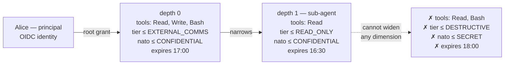

# Stratium: the concepts

For a technical reader who needs to understand *what this system is doing and
why it holds*, without reading the code. It is the layer beneath
[`architecture.md`](architecture.md), which is the mechanism in full detail, and
above [`user-guide.md`](user-guide.md), which is how to operate it.

Most sections are a page. Three go deeper, because they are the parts people
reconstruct wrongly from the names alone: **agent trust tiers**,
**classification caps**, and the **delegation chain**.

---

## 1. The problem

An AI agent is given a person's credentials and then acts on their behalf,
thousands of times an hour, choosing its own actions. Conventional
authorization has nothing to say about this. It answers *"is this user logged
in"* and *"does this API key exist"* — both of which stay true for the entire
session, whatever the agent does next.

Stratium changes the unit of authorization from the session to **the individual
tool call**:

> May **this agent**, acting under **this person's** delegated authority, at
> **this point in a delegation chain**, perform **this action** on **this
> resource**, right now?

`Bash("ls -la")` and `Bash("rm -rf /")` are the same tool, the same agent, the
same session, and the same credentials. They are not the same question.

---

## 2. The one rule everything else follows from

**The component being policed never classifies its own actions.**

The tempting design is to put a classifier next to the agent: look at the tool
call, decide "this is a read", tell the server. It is fast, it needs no round
trip, and it is worth nothing. Anything running inside the agent's process can
be lied to or replaced. An attacker picks a benign tool name, reports a benign
tier, and does whatever they want.

So Stratium's enforcement point forwards the tool call's arguments **verbatim,
as opaque bytes**, and the server derives everything from them: the action's
danger tier, the identity of the resource, the verb, the classification. The
enforcement point contributes no judgement at all.

The test to apply to any change in this system:

> *Could a hostile enforcement point get a better answer by lying?*

If yes, that logic is in the wrong process.

---

## 3. Three planes

| Plane | What it is | Trusted? |
|---|---|---|
| **PDP** — Policy *Decision* Point | The brain. Answers one RPC, `Decide`. Owns all classification, all derivation, all token verification. One process serves exactly one tenant, for its whole life. | Yes |
| **PAP** — Policy *Administration* Point | The admin plane. Policies, agents, the tool catalog, label rules, approvals. Authenticates a *human* over OIDC. | Yes — the only internet-facing part |
| **PEP** — Policy *Enforcement* Point | Runs beside the agent, on the agent's machine. Turns a tool call into a question and an answer into a block or a pass. | **No — untrusted by design** |

The PEP ships as four surfaces — a hook for CLI agents, an MCP proxy, an Envoy
`ext_authz` service, and a transparent gRPC proxy — and all four decide nothing.
Whichever one you deploy, the interesting behaviour is identical, because it all
happens on the other side of the wire.

---

## 4. What a decision is made of

Every decision is a conjunction of three independent legs:

```
allow = principal ∧ agent ∧ delegation
```

- **The principal leg** — may this *person* do this at all? This is the only leg
  policy engines answer (Cedar, Rego, XACML, or JSON, side by side in one
  tenant).
- **The agent leg** — is this *agent* enabled, trusted enough for this action,
  and permitted this tool? §5.
- **The delegation leg** — does the *granted authority* reach this far, at every
  hop of the chain? §7.

That structure is the load-bearing design choice, not a code layout. Because the
three are ANDed, **a policy cannot exceed a delegation**. An ALLOW from the
policy engine is one term of a conjunction, never an override of the other two.
Nothing a tenant can write in a policy language can raise a ceiling — and that
is not enforced by a check somewhere that could be forgotten. It is enforced by
the shape of the expression.

Denials win over allows, and are evaluated in a fixed order (principal, agent,
delegation) so that *why* a call was denied is the same answer every time.
Anything ambiguous denies: an unset field, a policy that could not be evaluated,
a label the system cannot rank, a chain that is not well-formed.

---

## 5. Agent trust tiers — depth

### Two different scales that are easy to confuse

There are two tier scales in this system, and almost every misunderstanding
starts by merging them.

**Action tier** — *how dangerous is this action?* Derived by the server, per
call, from the arguments:

| | Tier | Meaning |
|---|---|---|
| 0 | `REASONING` | no side effects |
| 1 | `READ_ONLY` | reads data |
| 2 | `INTERNAL_MODIFY` | mutates internal state |
| 3 | `EXTERNAL_COMMS` | reaches outside the trust boundary |
| 4 | `DESTRUCTIVE` | irreversible or financially binding |

**Agent trust tier** — *how much do we trust this actor?* A property of the
registered agent, set by an operator:

| | Trust tier | Meaning in practice |
|---|---|---|
| 0 | `UNVERIFIED` | a new or unknown agent |
| 1 | `REGISTERED` | known, identified, in inventory |
| 2 | `CERTIFIED` | reviewed against whatever bar the organization sets |
| 3 | `PLATFORM_TRUSTED` | first-party, operated by the platform team |

### The table that joins them

A single table maps each action tier to the **minimum trust required to attempt
it**:

| Action tier | Minimum trust |
|---|---|
| `REASONING` | `UNVERIFIED` |
| `READ_ONLY` | `UNVERIFIED` |
| `INTERNAL_MODIFY` | `REGISTERED` |
| `EXTERNAL_COMMS` | `CERTIFIED` |
| `DESTRUCTIVE` | `PLATFORM_TRUSTED` |

Read it in the direction that matters operationally: an `UNVERIFIED` agent can
never do more than read, whatever anyone grants it. A `CERTIFIED` agent can
reach the internet but can never be delegated the ability to `rm -rf`. Moving an
agent up the trust scale is what raises its ceiling, and that is an
administrative act performed by a human in the PAP, not something an agent can
ask for at runtime.

An action tier *missing* from the table returns the **highest** requirement, not
the lowest. A tier nobody thought about is a tier only a platform-trusted agent
may attempt — the failure mode of forgetting to configure something is
restriction, never permission.

### Why this is separate from the delegation

The obvious question: if the delegation already caps the action tier, what is
the trust tier adding?

They fail in different directions, and both checks apply:

- A **delegation** bounds *what a person handed over*. Alice can only grant an
  agent authority Alice herself holds, and she can hand it over for ten minutes.
- A **trust tier** bounds *what the platform is willing to let this software
  attempt at all*, independent of who is asking.

So an over-generous human cannot hand `DESTRUCTIVE` authority to an unverified
agent someone installed yesterday — the grant is real, and the agent leg denies
anyway. And conversely, a platform-trusted agent still cannot act outside the
narrow delegation it was given for this session. Neither substitutes for the
other; each closes a hole the other leaves open.

The agent leg also carries two blunter instruments that need no explanation but
are worth knowing exist: `enabled`/`suspended` (a reversible kill switch that
takes effect on the very next tool call across the whole fleet) and an optional
per-agent tool allowlist.

> **One sharp edge.** An empty allowlist means **unrestricted**, not "no tools".
> An empty list places no per-agent restriction and leaves the delegation as the
> only tool gate. It is the most commonly misread field in the system.

### What this does not yet do

Trust tier is an operator-asserted attribute. There is no attestation, no
signed provenance of the agent binary, nothing that *proves* an agent deserves
`CERTIFIED`. The tier is a place to record a decision a human made, and the
enforcement of that decision is real; the establishment of it is a process
question outside the system. The design also contemplates per-tenant overrides
of the trust table under the same raise-only discipline the action-tier table
uses — that part is unbuilt, and the code says so where it would go.

---

## 6. Classification caps — depth

### Two halves that must not be merged

Classification enforcement is two separate mechanisms that people routinely
collapse into one:

**Labelling** answers *what is this resource?* The tenant registers prefix
rules; the PDP resolves the resource identity it extracted itself to a
`(hierarchy, level)` pair by longest matching prefix.

```
""          → nato/UNCLASSIFIED     (catch-all)
"/secret/"  → nato/SECRET
```

**Capping** answers *how far up may this authority reach?* Each delegation
carries a per-hierarchy ceiling, and the resolved level is compared against it.

Two hierarchies ship, each an ordered list of levels:

| Hierarchy | Levels, low to high |
|---|---|
| `nato` | `UNCLASSIFIED` · `RESTRICTED` · `CONFIDENTIAL` · `SECRET` · `TOP-SECRET` |
| `commercial` | `PUBLIC` · `INTERNAL` · `CONFIDENTIAL-COMMERCIAL` · `RESTRICTED-COMMERCIAL` · `HIGHLY-CONFIDENTIAL` |

A cap on `nato` says nothing about `commercial`, and vice versa. Silence about a
hierarchy is not a denial — but silence about a *resource* is, which is the next
section.

### Why the fail-closed rules look paranoid

The recurring attack on any classification system is **bypass by omission**: not
claiming a lower level, which is a lie you can catch, but *saying nothing at
all* and hoping the comparison has no branch for that.

So the cap check is ordered, and the order is part of the contract:

| Situation | Result | Reasoning |
|---|---|---|
| The delegation declares no caps | allow | nothing was restricted |
| A cap is declared, the resource has no label | **DENY** | a restriction exists and cannot be checked |
| A label with no hierarchy | **DENY** | ambiguous |
| An unknown hierarchy or an unrankable level | **DENY** | a label the system cannot rank is unreadable, not permissive |
| A cap that does not mention the resource's hierarchy | allow | this cap says nothing about that hierarchy |
| Otherwise | rank comparison | resource level ≤ cap level |

The second row is the one that surprises people, and it is the whole point. "We
could not evaluate this" must never be recorded as "this was fine". The denial
reason says *cannot be evaluated*, deliberately not *satisfied*, so an audit
trail can tell the two apart later.

Two consequences worth internalising before you deploy:

- **There is no default level.** An unmatched resource is unlabelled, and an
  unlabelled resource denies under any cap. The fix is to write an
  empty-prefix catch-all rule, not to invent a floor in code — because a floor
  in code is a floor that applies to resources nobody has thought about.
- **A tool that names no resource cannot be labelled at all.** A search or a
  fetch tool declaring neither a resource field nor a command field produces no
  resource identity, so no rule matches — not even the catch-all — and under a
  cap it denies outright. A shell tool is the exception: it declares a *command*
  field, and every path its command names becomes an identity, with the
  strictest resulting label deciding. A shell command naming no path is back in
  the first case.

### Where the caller is cut out

Two rules make "the PDP never takes a classification from the caller" a property
of the server rather than a hope about its clients:

1. The PDP **strips** the `classification` and `hierarchy` keys from the
   caller's resource map unconditionally, before writing its own. Not because
   any shipped enforcement point sends them — because then no future one can.
2. The label is resolved against **the identity the PDP extracted itself**, not
   against whatever the caller called the resource. Reading it back from the
   caller's map would let an attacker name a decoy that matches a permissive
   rule: the claim would be gone but the lever that selects the claim would
   still be in the caller's hands.

### How a cap gets into a chain

A cap is set once, by an administrator, on the **agent**. When a root delegation
is minted it copies the agent's caps — a root has no parent to be bounded by, so
this is where the ceiling enters. Every child copies its parent's and may only
narrow. Nobody negotiates a cap at runtime, and no delegation can acquire a
looser one than the one above it.

---

## 7. The delegation chain — depth

### The certificate analogy, and where it stops

If you know X.509 path validation with name constraints, you already have most
of the mental model. A delegation chain is a lineage of grants where each link
may only ever be a subset of the one above it, validated hop by hop from a root
of trust downward.



Where the analogy holds:

- **Narrowing only.** Every dimension is checked when a child is created —
  action tier, escalation threshold, tool set, classification caps, resource
  constraints, expiry. An identical child is fine; a wider one in any single
  dimension is rejected outright.
- **Verification walks the whole path.** At decision time every hop is checked
  root-first, not just the one being presented. A revocation five hops up denies
  a call made at the bottom.
- **A root of trust.** The root grant comes from an authenticated human, and is
  itself clamped to authority that person's own policies show they hold. Nobody
  can delegate what they never had.

Where it stops, and this is the part worth carrying away:

- **The credential does not carry the chain.** The token an agent holds is a
  small signed JWT whose subject is *a delegation id* — plus the tenant, its
  lifetime, a unique id, and optionally a key thumbprint. It is a pointer, not a
  bundle. The chain is reloaded from the database on **every single decision**.
- **So the token is authentication, never authorization.** It answers "which
  delegation is being presented" and nothing else. The delegation it names is
  then evaluated fresh, so a revoked or expired grant denies at the delegation
  leg — never at the token.
- **Which means revocation is immediate and needs no CRL, no OCSP, no
  distribution.** Flip a row, and the very next call reads it. This is the
  single biggest practical difference from a certificate PKI, and it is bought
  by requiring a round trip that a certificate deliberately avoids.
- **There is also no key distribution problem**: the PDP verifies tokens it
  signed itself, so there is no JWKS endpoint on the enforcement path.

### What "narrowing" actually means

Two rules are stricter than pure logic requires, deliberately.

**Omission is widening.** The check iterates the *parent's* constraints, not the
child's. A child that simply leaves out a hierarchy its parent capped has not
inherited that cap — at decision time, an absent cap means no restriction, so
the omission would be a promotion. Same for tools: an empty child list under a
restricted parent is a widening, not an inheritance.

**A child may not introduce a dimension its parent left open**, even though
adding a constraint genuinely does restrict it further. The reason is
auditability rather than security: it makes a child's shape derivable from its
parent's, so reviewing a chain means comparing values across a fixed set of
dimensions instead of tracking which hop invented which dimension.

And one direction that reads backwards until you say it out loud: the
escalation threshold narrows *downward*. A lower threshold escalates sooner, so
lowering it narrows and raising it widens.

### Well-formedness is checked before anything is decided

Before any of that runs, the chain itself has to be a genuine lineage: the first
hop must have no parent and claim depth 0, every hop must belong to the request's
tenant and name the same root, each hop's parent must be its actual predecessor,
depths must increment by one, and — the one that matters most — **the last hop
must have been issued to the agent presenting it**. Without that check, an agent
can act under someone else's grant.

A malformed chain is not a denial. It is a distinct failure: a denial means the
chain is valid and does not authorize this action, whereas this means the chain
cannot be trusted to mean anything at all.

Chains are bounded: the decision path enforces a configurable maximum depth
(default 5), and the database walk that assembles a chain has its own hard stop
well above it, so a cycle introduced by a bad write cannot become an infinite
loop.

---

## 8. The rest of the system, briefly

These need less depth, but you cannot reason about the system without knowing
they exist.

**Where the action tier comes from.** The server resolves it in order:
tenant-specific overrides, then the tenant's tool catalog, then a built-in
classifier over the raw command text, then a configured floor. Above all four
sits one rule: a positive destructive-or-external match on the raw input is
*evidence*, and evidence is never lowered — only raised. Overrides and catalog
rows are keyed on a tool *name*, so without that rule an enforcement point could
choose a benign name for a hostile call and pick its own tier. Tenant overrides
may only ever raise a tier, checked both when written and again when read.

**The classifier is a heuristic and the code says so.** Base64 piped to a shell
defeats any static matcher. The classifier's job is to stop an action being
*accidentally* or *casually* under-rated; the real controls are the delegation
ceiling, the trust tier, the allowlist, and escalation.

**Escalation.** A delegation can carry a band — at or above tier X, don't allow,
ask a human. An escalation creates a pending approval that a human resolves in
the PAP. The invariant: an approval is layered *on top of* a fresh three-leg
evaluation, never instead of one. An approval can never resurrect a request the
three legs would refuse, and a request above the ceiling denies before it can
ever create an approval row.

**The epoch and the cache.** Every tool call is a synchronous round trip, which
is a problem the moment the PDP is unreachable. A decision cache buys outage
tolerance, keyed on the delegation, the tool, and a hash of the exact arguments.
A per-tenant counter — bumped by a *database trigger* on every configuration
write, never by application code — invalidates every cached entry the instant
anything changes. Escalations are never cached; a pending human decision is not
a verdict. Only the two surfaces whose caller is local may consult the cache at
all, and that restriction is enforced by the type system rather than by a
comment: on the network surfaces the caller *is* the party being policed, and a
cache hit is by definition a decision made without asking the only component
that verifies signatures.

**Tenancy.** The tenant is never a request field — it is startup configuration.
Isolation is Postgres row-level security, forced on every table, and the
application code never writes a `WHERE tenant_id` clause. A second
implementation of the boundary is worse than none, because when the two disagree
the weaker one wins silently. A consequence to expect: "belongs to another
tenant" and "does not exist" are indistinguishable by design.

**Audit.** Every decision is recorded whatever the outcome, in an append-only
hash-linked chain that a database trigger protects from truncation. A failed
audit write fails the call: an ALLOW that was not recorded is not returned. Raw
tool inputs are never stored — only a digest — because writing raw shell
commands into an undeletable table before per-tenant key management exists would
be worse than not storing them.

---

## 9. Four sentences

1. The enforcement point forwards bytes and enforces an answer. It classifies
   nothing.
2. The decision point derives the tier, the resource identity, and the
   classification itself, from data it trusts — never from a caller's claim.
3. `allow = principal ∧ agent ∧ delegation`, with the delegation as a
   structural ceiling no policy can raise and the trust tier as a floor no
   delegation can lower.
4. Every ambiguity denies.

---

## 10. Where to go next

| You want | Read |
|---|---|
| The mechanism in full, traced against a live stack | [`architecture.md`](architecture.md) |
| To install, configure, and operate it | [`user-guide.md`](user-guide.md) |
| To get something running quickly | [`quickstart.md`](quickstart.md) |
| The enforcement surfaces in operator detail | [`pep.md`](pep.md) |
| The design of record | `docs/superpowers/specs/2026-08-08-agent-authorization-redesign-design.md` |
