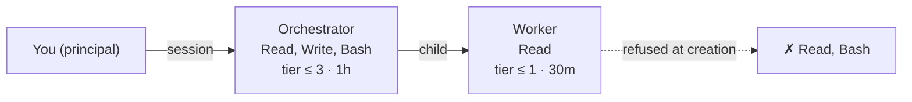

# Hand a sub-agent less

**You are** building an agent that spawns workers. **You want** each worker to
hold only what its task needs, and to be sure no worker can end up with more
than the orchestrator that created it.

Each worker gets a **child delegation**, issued from the orchestrator's own.
Stratium refuses a child that is wider than its parent in any way, and on every
call it rechecks the whole chain from the person at the top down.



## 1. Register the worker as its own agent

Each hop in a chain belongs to an agent, so the worker needs its own agent
record:

```bash
curl -sS -X POST "http://$PAP/v1/agents" \
  -H "Authorization: Bearer $EDITOR" -H 'Content-Type: application/json' \
  -d '{"name":"report-worker","provider":"anthropic","model_id":"claude",
       "trust_tier":1,"enabled":true,"suspended":false,"allowed_tools":["Read"]}'
```

## 2. Issue the child from the orchestrator's delegation

Child delegations are created with the [Python SDK](https://github.com/stratiumdata/stratium/blob/main/sdk/python/README.md)
(or the PDP's `CreateDelegation` call directly). The `stratium-pep` command line
creates sessions only.

```python
from stratium import Client, Session

# TLS by default. Private CA: Client(pdp_addr, ca_file="/path/to/ca.pem").
# Local Docker stack (plaintext): Client(pdp_addr, insecure=True).
with Client(pdp_addr) as client:
    orchestrator = Session(
        client, subject="you@example.com", agent_id=ORCHESTRATOR_ID,
        tools=["Read", "Write", "Bash"], max_action_tier=3,
        purpose="nightly report", ttl_seconds=3600,
    )

    worker = client.create_delegation(
        subject="you@example.com", agent_id=WORKER_ID,
        tools=["Read"], max_action_tier=1,
        purpose="summarise logs", ttl_seconds=1800,
        parent_delegation_id=orchestrator.grant.delegation_id,
        parent_token=orchestrator.grant.token,
    )

    decision = client.decide(
        agent_id=WORKER_ID, subject="you@example.com", tool="Read",
        raw_input={"file_path": "/workspace/logs/today.log"},
        token=worker.token,
    )
```

## What Stratium enforces

- **The child may only narrow.** Tools, tier ceiling, classification caps,
  workspace scope, escalation threshold, and expiry must each be equal or
  tighter. Asking for a tool the parent doesn't hold fails at creation:
  `child tool "Write" not in parent approved_tools`.
- **Expiry counts.** Give the child a shorter TTL than the parent. An identical
  TTL fails, because the child is created a moment later and would outlive it.
- **The whole chain is checked on every call.** Revoking the orchestrator's
  delegation immediately denies every worker below it.
- **Each hop is held by its own agent.** A worker can't present the
  orchestrator's delegation, or another worker's.
- **Only the holder can narrow a delegation.** Creating a child needs the
  parent's own current token (`parent_token`), not just its id, and the child
  must be for the same person as the chain.

Denials from a worker say `at depth 1` (or deeper), so you can tell which hop
refused.

## Limits to know

- **A child can't add a limit its parent left open.** If the orchestrator has
  no classification cap or workspace scope, a worker can't introduce one.
  Set the tightest dimensions you will need on the orchestrator's agent, so
  workers can narrow them further.
- **Workers inherit the orchestrator's [approval threshold](require-approval.md)**
  and may lower it (pass `escalate_at=` to `create_delegation`). A worker
  whose own ceiling sits below the threshold drops it, since it could never
  reach it, so handing a worker less authority never makes it ask for
  approval more often. If the orchestrator has **no** threshold, a worker
  can't add one (`child introduces escalate_at`), the same rule as caps and
  scope: set it on the orchestrator's agent instead.
- **Chains are capped in depth** (5 by default).
- **Siblings aren't compared with each other.** Two workers can each be within
  bounds yet together reach more than either alone. Use
  [effective permissions](review-a-change.md#see-everything-one-person-has-handed-out)
  to see the combined reach.
